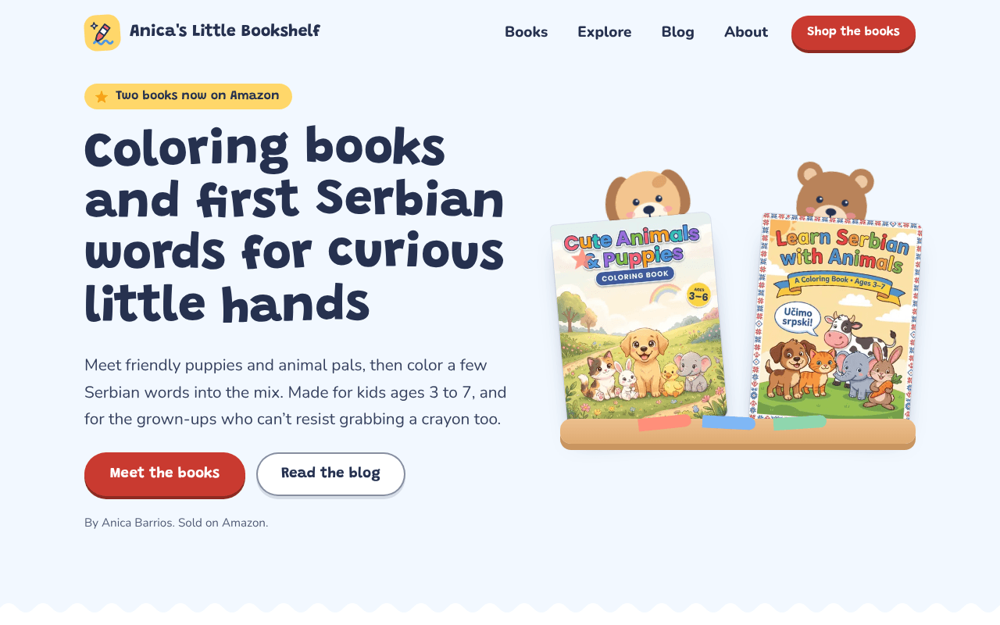
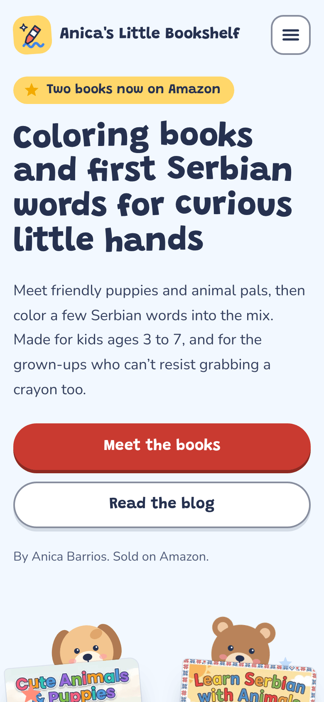

# Anica's Little Bookshelf

[](https://www.anicasbookshelf.com/)


A one-page website that shows the children's books published on Amazon KDP, with a link to each book and a small blog.

<table>
  <tr>
    <td width="72%"></td>
    <td width="28%"></td>
  </tr>
</table>

## Table of contents

- [About](#about)
- [Features](#features)
- [Live site](#live-site)
- [Tech stack](#tech-stack)
- [Getting started](#getting-started)
- [Usage](#usage)
- [Configuration](#configuration)
- [Project structure](#project-structure)
- [Deployment](#deployment)
- [Documentation](#documentation)
- [Support](#support)
- [Contributing](#contributing)
- [Project status](#project-status)
- [Author and credits](#author-and-credits)
- [License](#license)

## About

I publish children's coloring books on Amazon KDP: animal and puppy coloring books, and a book that teaches first Serbian words. This site gives all of them one home. Each book has a card with its cover, ages and a button to Amazon, and the blog adds coloring ideas and Serbian words for parents.

Every page is turned into plain HTML when the site is built. Search engines, social networks and AI assistants read the real text, and React then takes over in the browser.

## Features

- Book cards with cover, ages, description and an Amazon button. A new book is one entry in a data file.
- An Explore section with upcoming holidays and two small games: Word match and Which holiday?
- Responsive layout with a light theme.

## Live site

- Home: <https://www.anicasbookshelf.com/>
  - [Books](https://www.anicasbookshelf.com/#books), [Explore](https://www.anicasbookshelf.com/#explore) and [About](https://www.anicasbookshelf.com/#about) sections
- Blog: <https://www.anicasbookshelf.com/blog/>
  - [8 Easy Thanksgiving Activities for Toddlers & Preschoolers](https://www.anicasbookshelf.com/blog/thanksgiving-activities-for-toddlers/)
  - [Friendly Halloween Coloring Ideas for Kids Ages 3 to 6](https://www.anicasbookshelf.com/blog/halloween-coloring-ideas-for-kids/)
  - [Learn Serbian for Kids: Why Animals Make the Best First Words](https://www.anicasbookshelf.com/blog/learn-serbian-for-kids/)
- Books on Amazon: [Cute Animals & Puppies](https://www.amazon.com/dp/B0HMFKKKR3) and [Learn Serbian with Animals](https://www.amazon.com/dp/B0HMFMV1XJ)


## Tech stack

- [React](https://react.dev/) 18 and [Vite](https://vite.dev/) 6
- [gray-matter](https://github.com/jonschlinkert/gray-matter) and [marked](https://marked.js.org/) for the Markdown blog
- [sharp](https://sharp.pixelplumbing.com/) for small WebP copies of the covers
- [Fontsource](https://fontsource.org/) for the fonts (Grandstander and Nunito), served from the site itself
- [Netlify](https://www.netlify.com/) for hosting

## Getting started

### Prerequisites

- Node.js 20.9 or newer
- npm

### Installation

Clone or download the repository, then run this in the project folder:

```bash
npm install
```

### Run locally

```bash
npm run dev
```

The site opens on <http://localhost:5173>. The dev command also makes the cover WebP files and the blog pages, so there is nothing else to run first.

### Build

```bash
SITE_URL=https://www.anicasbookshelf.com npm run build   # macOS and Linux
```

The finished site is in `dist/`. Check it with `npm run preview`. The site address is needed for canonical links, the sitemap and the RSS feed. On Netlify it is filled in automatically (see [Configuration](#configuration)).

### Commands

| Command | What it does |
| --- | --- |
| `npm run dev` | Starts the dev server |
| `npm run build` | Builds the finished site into `dist/` |
| `npm run preview` | Serves `dist/` locally to check the build |
| `npm run covers` | Makes WebP copies of the covers in `public/covers/` |
| `npm run blog` | Builds the blog pages, sitemap, `robots.txt` and RSS feed |

## Usage

### Add a book

Put the cover JPG in `public/covers/`, run `npm run covers`, then add the Amazon link and one entry to [`src/data/content.js`](src/data/content.js):

```js
// 1. In AMAZON, add the link:
myBook: 'https://www.amazon.com/dp/XXXXXXXXXX',

// 2. In the BOOKS list, add one more object:
{
  id: 'my-book',
  title: 'My Book',
  ages: 'Ages 3–6',
  description: 'One or two sentences about the book.',
  href: AMAZON.myBook,
  tone: 'sky', // card color: 'sky' or 'butter'
  character: 'puppy', // drawing used when there is no cover: 'puppy' or 'bear'
  languages: ['en'],
  cover: cover('my_book', 1000, 1293), // file name without .jpg, width, height
},
```

The hero shelf, the cards, the buttons, the structured data and the blog links update on their own. Details: [Adding a book](docs/adding-books.md).

### Add a blog post

Add a Markdown file to `content/blog/`, for example `content/blog/my-new-post.md`, starting with this front matter:

```yaml
---
title: "My post title"
seoTitle: "Title for search results (up to 60 characters)"
description: "Search result text, 120 to 160 characters."
date: "2026-10-21"
tag: Holidays
tone: mint # mint, blush or blue
art: puppy # puppy, bear or pumpkin
excerpt: "Short text for the blog card."
imageAlt: "Describes the card drawing"
book: cute-animals # the book to promote under the post
keyword: the phrase the post should rank for
---

The post text in Markdown.
```

The next build prints warnings if something is off for search engines and stops if something would break a page. Details: [Adding a blog post](docs/adding-blog-posts.md).

## Configuration

Site-wide settings are in [`src/data/site.js`](src/data/site.js).

| Setting | What it does |
| --- | --- |
| `SITE_URL` (environment variable) | The site address, for example `https://www.anicasbookshelf.com` |
| `URL` (set by Netlify) | Used when `SITE_URL` is not set |
| `CONTEXT` (set by Netlify) | Anything other than `production` makes the pages `noindex`, so test copies stay out of Google |
| `SITE.sameAs` | Addresses of the author's other profiles (Amazon Author Central, social media) for structured data |
| `SITE.allowAiTraining` | `false` asks AI training crawlers (`GPTBot`, `ClaudeBot`) not to use the pages. AI search and assistant crawlers stay allowed |

The build stops with a clear message while the site address is still the placeholder `https://example.com`.

## Project structure

```
content/blog/       blog posts, one Markdown file each
docs/               documentation and README screenshots
public/             files copied as they are: covers, share pictures, favicon
scripts/            build steps: blog pages, sitemap, covers
src/blog/           article and blog list pages
src/components/     React components of the home page
src/data/           site settings, books, holidays, games, navigation
src/pages/          404 page
src/styles/         CSS, one file per area
netlify.toml        Netlify build and header settings
```

`blog/`, `404.html` and `src/data/posts.generated.json` are generated by the build. Do not edit them by hand.

## Deployment

The site is hosted on Netlify. [`netlify.toml`](netlify.toml) holds the build command, the Node version, caching and security headers, so connecting the repository is enough: **Add new site, Import an existing project**, pick the repository and deploy. Every push to the production branch deploys again. Custom domain, other hosts and manual uploads are in [Deployment](docs/deployment.md).

## Documentation

- [Adding a book](docs/adding-books.md)
- [Adding a blog post](docs/adding-blog-posts.md)
- [Deployment](docs/deployment.md)
- [SEO and AI crawlers](docs/seo.md)
- [Customizing the look](docs/customizing.md)

## Support

Found a bug or have a question? [Open an issue](../../issues) in this repository.

## Contributing

This is a personal project. Suggestions and bug reports are welcome as issues. For a code change, please open an issue first so it can be discussed.

## Project status

Active. New books and blog posts are added as they are published.

## Author and credits

Made by Anica Barrios ([anicasbookshelf.com](https://www.anicasbookshelf.com/)).

Fonts: Grandstander and Nunito, both under the SIL Open Font License, packaged by [Fontsource](https://fontsource.org/).

## License

Copyright (c) 2026 Anica Barrios. All rights reserved.
